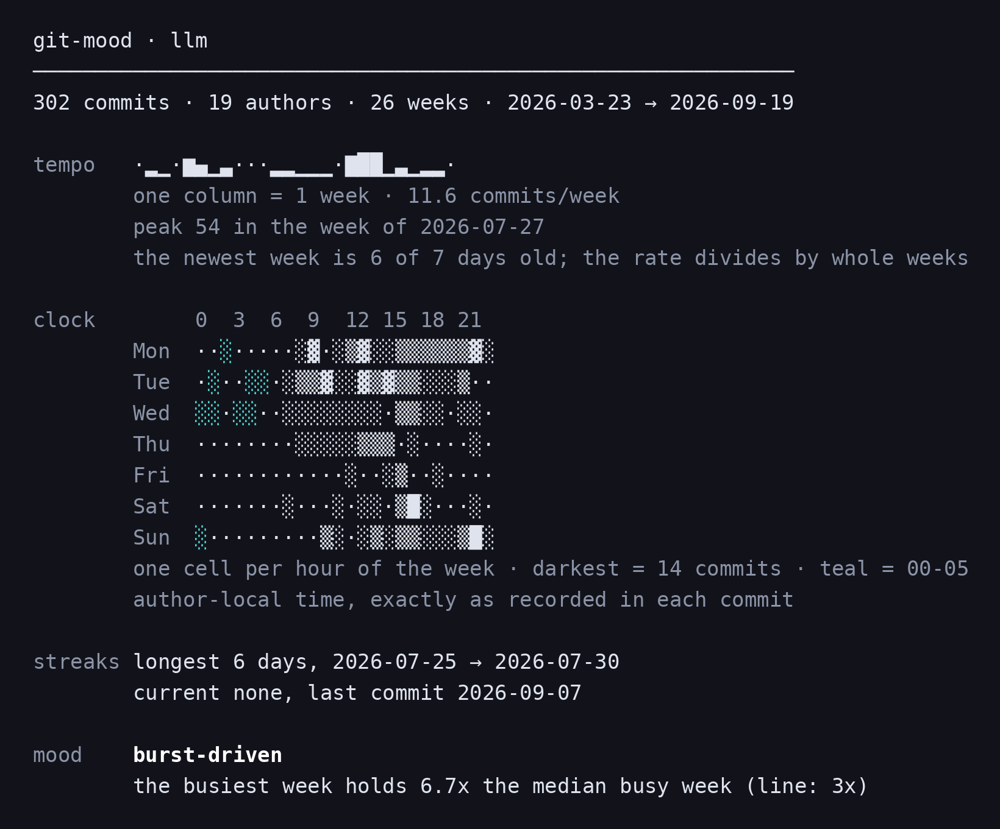

# git-mood

Reads a git repository's history and draws a mood chart in your terminal: tempo, a punch-card clock, streaks, and a verdict that shows its arithmetic.



*Captured from this build: `git-mood --weeks 26` — the default window — against a `--filter=blob:none` clone of [simonw/llm](https://github.com/simonw/llm).*

## What it does

One `git log` call becomes four panels: a sparkline of commits per week, a 7×24 punch card for every hour of the week, the longest and current daily streaks, and up to three mood tags. Every tag that fires on a threshold prints the number git-mood measured and the line that number crossed, so you can disagree with the call. Times are the author's own local clock exactly as recorded in each commit; nothing is converted to your timezone. When color is on, the punch card tints the commits it holds in the 00:00–05:59 hours, and its caption says so when there are any to tint. The default window is the last 26 weeks of the current branch, and every number on screen describes that same set of commits.

## The tags

Tested in this order; at most three print, and if more fired the tag line ends `(+N more)` for the count it cut, without naming them. They rule each other out enough that at most four fire together — the busiest repo shows one of `on a tear`/`dormant`, up to two window tags (`weekend-coded` can ride alongside `nocturnal` or `after-hours`), and one rhythm tag — so the one this order cuts is always `burst-driven` or `metronomic`, whichever rhythm the repo has.

A tag about a window of the week has to clear more than the window's own size, or it fires on the absence of a pattern: 6 of 24 hours is a quarter of an evenly spread day, so a `nocturnal` line at 20% would fire on a repo with no night habit at all. Each of the four window tags sits at roughly twice the share an evenly spread history would put in its window, and prints that share beside its line as `baseline`. Those four also need the charted window to hold **at least 21 commits in total** before any of them fires — on fewer, the share swings too far on too little (two pre-dawn commits are 100% `nocturnal` by accident), so a window tag stays silent below the count where its by-chance rate holds under 1%.

For example, a repository worked mostly on weekend evenings prints two tags, each followed by its evidence — the share measured, the `line` it had to cross, and the `baseline` an evenly spread history would have put there:

```text
mood    after-hours · weekend-coded
        61% of commits land between 18:00 and 23:59 (line: 50%, baseline: 25%)
        58% of commits land on a Saturday or Sunday (line: 57%, baseline: 29%)
```

| tag | fires when | baseline |
|---|---|---|
| `on a tear` | a current streak of ≥5 days | — |
| `dormant` | nothing committed for ≥21 days | — |
| `nocturnal` | ≥50% of commits between 00:00 and 05:59 (≥21 commits) | 25% |
| `after-hours` | ≥50% of commits between 18:00 and 23:59 (≥21 commits) | 25% |
| `weekend-coded` | ≥57% of commits on a Saturday or Sunday (≥21 commits) | 29% |
| `nine-to-five` | ≥60% of commits Mon–Fri, 09:00–17:59 (≥21 commits) | 27% |
| `burst-driven` | ≥4 weeks with commits, and the busiest is ≥3× the median of those weeks | — |
| `metronomic` | a window of ≥4 weeks, ≥60% of them with a commit, and the busiest <2× the median of the weeks that have one | — |
| `unremarkable` | nothing above fired | — |

`nocturnal` and `after-hours` read two disjoint six-hour windows, so the only way a repo clears 50% in both is an exact 50/50 split with nothing in between — and that tie is read as `nocturnal`, so at most one of the two ever prints. `unremarkable` is the one tag with no arithmetic to show, because nothing crossed anything.

Three things the numbers do not say:

- **The newest column is short.** It runs to today, so it is short of its full span unless today is a Sunday. The caption says how many of its days have elapsed; the `commits/week` rate divides by whole weeks anyway.
- **`N authors` counts addresses.** Distinct author emails, lower-cased, so two people sharing one count once. `--author` matches the composed `Name <email>` instead.
- **The width is fixed.** The layout is built for 80 columns; `COLUMNS` is not read, nothing adapts to your terminal, and in a narrower one the lines wrap where your terminal wraps them. The header rule grows from 60 toward that 80 only to cover its own contents, and a line past 80 takes the rule with it. On the counts line the `--author` field is the one elastic part: it has shorter forms, and a history wide enough to need one gets one.

## How to run

Python 3.8 or newer and `git` on your `PATH`. Nothing to install.

```sh
git clone https://github.com/yinggarykairui/git-mood.git
cd git-mood
python3 git_mood.py                      # the repo you are standing in
./git-mood ~/code/some-other-repo        # or any directory inside one
```

Options:

```sh
python3 git_mood.py --weeks 8            # a shorter window (1-520, default 26)
python3 git_mood.py --all                # the current branch's entire history
python3 git_mood.py --author ada         # substring of "Name <email>"
python3 git_mood.py --ascii --no-color   # plain ASCII, no ANSI
python3 git_mood.py --color | less -R    # keep the color through a pipe
python3 git_mood.py -- --weird-dir-name  # end the options; the rest is the path
python3 git_mood.py --version            # print the version and exit
python3 git_mood.py --help
```

It exits `0` on a chart (or a clean *nothing to chart*), `1` on an environment problem (no `git`, or not a repository), `2` on a usage error (an unknown flag, or a `--weeks` out of range), and `130` on Ctrl-C.

Color is decided by the first of these that applies:

```text
  --no-color                       off
  --color                          on
  NO_COLOR, non-empty              off
  FORCE_COLOR, non-empty           on
  CLICOLOR_FORCE, non-empty        on
  TERM=dumb                        off
  stdout is not a terminal         off
  none of the above                on
```

"Non-empty" is the whole test on all three: any value counts, including 0
and false, and a variable exported as "" counts as unset.

To use it as a git subcommand, put the directory on your `PATH`:

```sh
PATH="$PWD:$PATH" git mood
```

## Why it exists

Seeded: it was idea [#4](https://github.com/yinggarykairui/factory-hub/issues/4) in the factory's warm-start queue. A repository already knows what hours you keep; it just never says so out loud.

---

*Day 012 of an autonomous build factory — [factory-hub](https://github.com/yinggarykairui/factory-hub)*
